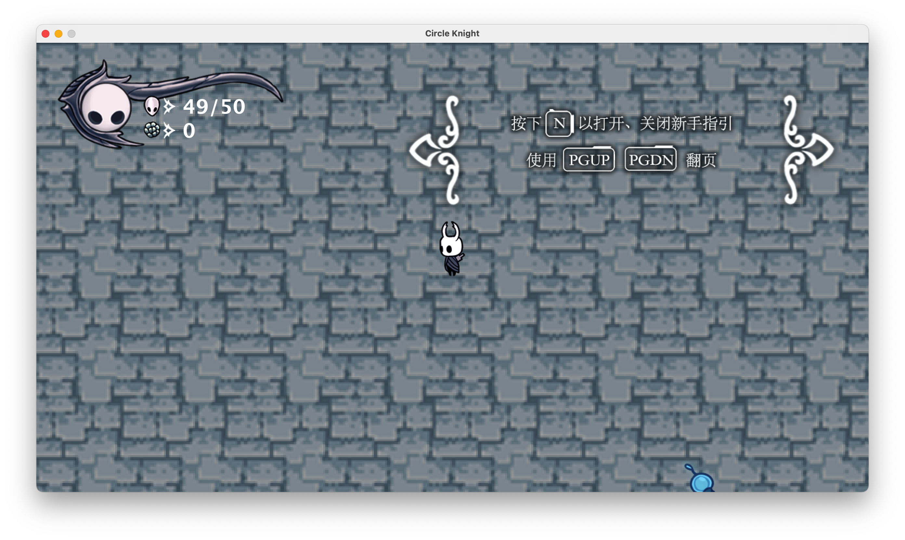
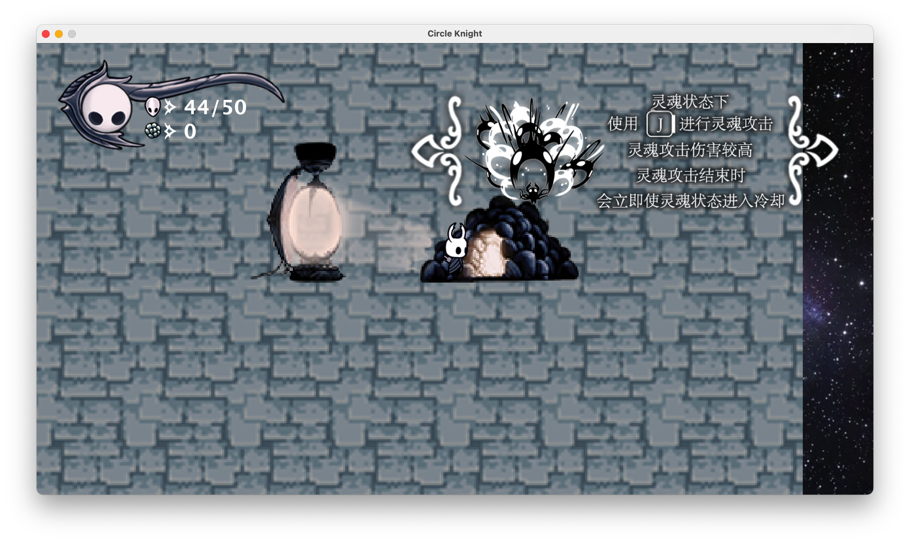
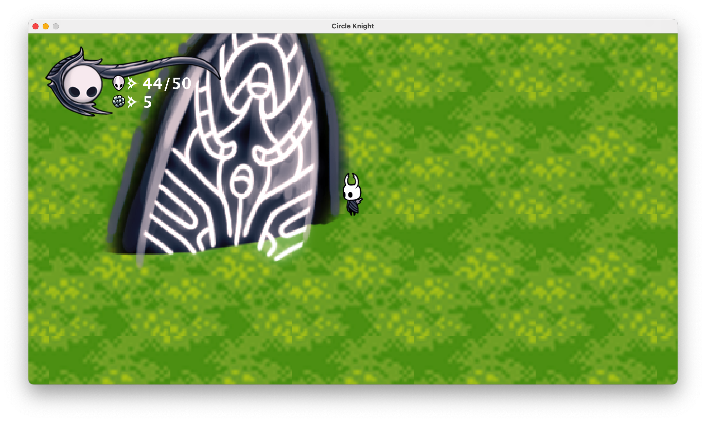
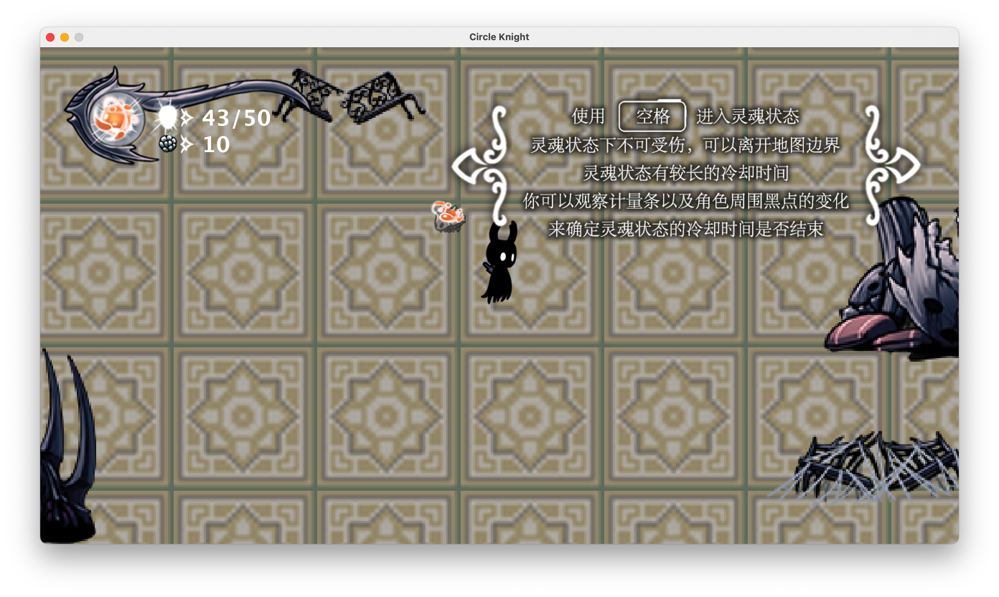

# Little Knight / Circle Knight

2022 年大一暑期完成的 Java Swing 二维俯视角动作小游戏。项目从零学习 Java 起步，围绕角色移动、攻击、灵魂技能、怪物巡逻与地图切换，实现了一套可以游玩的小游戏流程。项目目录沿用 **Little Knight**，游戏窗口标题为 **Circle Knight**。

游戏的灵感和美术素材来自《空洞骑士》。与原作死亡后留下灵魂的设计不同，这里将「灵魂状态」做成主动技能：可以暂时避开物理伤害、越过地图边界，也能释放伤害更高的灵魂攻击。

## 游戏截图

以下四张截图来自 2026 年恢复运行后的实际游玩，作者已确认体验与当年的版本一致。

### 初始地图与新手引导

角色保持在画面中央，地图随移动滚动；左上角显示生命值与金币，右侧是可以翻页和隐藏的新手引导。



### 传送门与地图探索

接近传送门后按 F 切换场景。不同地图及进入方式对应不同出生位置。



### 绿色地图

三张地图分别由独立子类配置，拥有不同尺寸、传送门位置、出生点与怪物生成概率。



### 灵魂状态

按空格进入灵魂状态，角色外观与状态栏随之变化；灵魂攻击结束后会进入技能冷却。



## 已实现的内容

- **角色与战斗**：WASD 移动、左右近战攻击、碰撞伤害、击退、死亡后复活，以及生命值和金币显示。
- **灵魂技能**：灵魂状态、持续时间与冷却、灵魂攻击，以及对应的角色和怪物图像切换。
- **地图与怪物**：CrossRoad、Greenpath、CityOfTears 三张地图，LifeSeed、SilverReptile 两类怪物，随机生成、巡逻及不同的死亡收益。
- **菜单与引导**：窗口尺寸、刷新间隔和难度设置，以及九页游戏内教程。

原始构思中的商店、武器和经验系统未作为已完成功能收录；怪物主动攻击逻辑也未完成。

## 快速运行

环境要求：**Python 3.8+、JDK 14+**。首次运行会编译源码，之后可使用 Java 14+ 运行生成的 JAR。只依赖 Java 标准库与 Python 标准库，无需安装第三方包。

```sh
git clone https://github.com/AkashiSensei/BUAA-Java-Summer-2022.git
cd BUAA-Java-Summer-2022
python3 tools/manage.py run
```

macOS 也可以双击 `run.command`。Windows 可使用 `py -3 tools/manage.py run`。

工具会优先检查 `JAVA_HOME`，在 macOS 上也会查找已注册的 Java 和 IntelliJ IDEA 自带的运行环境，再尝试 PATH 中的 Java。版本不足时会提示需要 Java 14+；系统默认 Java 8 无法运行本项目。

图片通过相对文件路径加载。启动工具会自动切换到项目根目录；请保留整个 `img/` 目录，不要只移动 JAR。

## 键位

| 场景 | 按键 | 功能 |
| --- | --- | --- |
| 菜单 | H | 进入设置 |
| 设置 | Q / W / E | 选择窗口尺寸 |
| 设置 | A / S / D / F | 选择刷新间隔 |
| 设置 | Z / X / C | 选择难度 |
| 设置 | 空格 | 开始游戏 |
| 游戏 | W / A / S / D | 移动 |
| 游戏 | J | 普通攻击；灵魂状态下为灵魂攻击 |
| 游戏 | 空格 | 进入或结束灵魂状态 |
| 游戏 | F | 在传送门附近切换地图 |
| 游戏 | N | 显示或隐藏教程 |
| 游戏 | Page Up / Page Down | 翻阅教程 |

Mac 紧凑键盘可尝试 Fn + 上/下方向键翻页。窗口尺寸为 1024×576、1280×720、1600×900；刷新间隔为 64、32、16、8 ms，实际帧率还受逻辑执行及线程调度影响。

## 实现方式

- 通过 Swing 的 `JFrame`、`JLabel` 和 `ImageIcon` 组织窗口、场景与动画；刷新时改变组件位置和图标。
- `Status` 维护窗口、难度和游戏状态；`LittleKnight` 维护角色动作、技能及属性。
- 抽象类 `MyMap` 和 `Monster` 定义地图与怪物的共同行为，子类提供具体配置和死亡效果。
- 角色、地图与怪物通过相对坐标计算显示位置；使用矩形判定攻击和碰撞，通过线程处理刷新、动作时序及巡逻。

这是学习 Java 和面向对象设计时的早期作品。当前归档保留提交版源码，没有为了适配新环境重写游戏逻辑；多线程更新 Swing 组件、固定尺寸菜单等仍保留原实现。

## 构建与检查

```sh
python3 tools/manage.py build
python3 tools/manage.py check
```

`build` 编译全部 13 个源码文件，生成 Java 14 目标字节码的 `LittleKnight.jar`。`check` 同时验证源码引用的 69 张图片是否存在、能否被 Swing 解码，不会打开游戏窗口。

原环境为 Windows 10、Java 14.0.2；2026-10-13 使用 macOS、Java 21 重新编译和启动，作者已实际游玩并确认与记忆中的版本一致。没有据此宣称所有难度和完整通关流程都经过系统回归。

## 目录

```text
src/                    原始提交版源码
  GameStatus/           游戏状态
  Maps/                 地图抽象与具体地图
  Monsters/             怪物抽象与具体怪物
  Player/               角色逻辑
  Windows/              菜单、主窗口、教程与结束界面
img/                    69 张运行必需的图片
docs/
  screenshots/          四张实际游玩截图
  DEVELOPMENT.md        原开发文档的文字归档
  RECOVERY.md           版本辨识与恢复验证记录
  SOURCE_SHA256.json    原始源码校验值
tools/manage.py         构建、运行与资源检查
run.command             macOS 启动入口
```

构建产物不提交；本地保留的 PSD、未使用素材、原 JAR 和另一版源码备份也不纳入仓库。版本依据和差异说明见 [恢复记录](docs/RECOVERY.md)，原开发思路见 [开发文档](docs/DEVELOPMENT.md)。

## 素材来源

原开发文档说明：美术素材来自《空洞骑士》，并使用 Photoshop 进行了编辑。游戏程序、素材编辑和玩法实现属于本课设的开发工作；原作角色与美术素材的权利属于各自权利人。本仓库用于保存课程学习成果，不对第三方素材授予新的许可。
